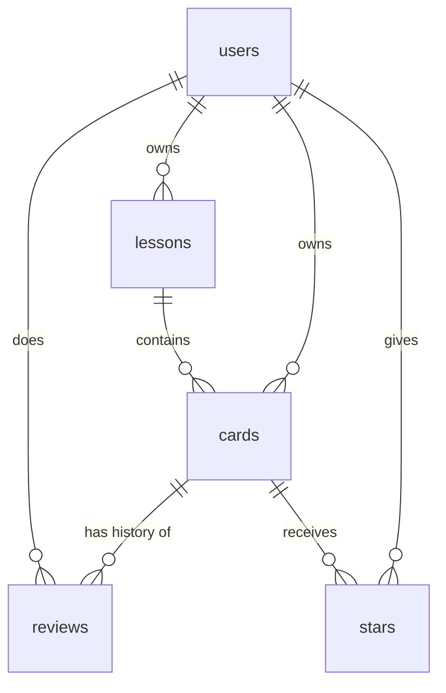

# korean-study-app
Intro to Code repo to build Korean study app

## 1. Pitch

"I'm building a Korean-language study app because I want to be able to consistently revisit material and track how well I know it." I would like to use this app daily, for 10–15 minutes before each Korean class and before quizzes.

All of my vocab comes from my textbook, and I already keep it in a spreadsheet (Korean_Vocab_Bank.xlsx, 257 words across Lessons 1–5). The app turns that spreadsheet into flashcards I can study, star, search and track.

## 2. Features

Built in this order, one pull request each. Features 1–7 are the required spine; features 8–11 are my own.

| # | Feature | User story |
| -------- | -------- | -------- |
| 1 | Sign up and log in | As a new visitor, I want to create an account with my email and a password (at least 6 characters), log in and log out, so that my vocab and study history are private to me. |
| 2 | Data model | As a student, I want my words organized into textbook lessons (lesson number + topic, like 2 · 학교생활 School life), so that I can choose to study one lesson at a time like my class does. |
| 3 | Create / read / update / delete | As a student, I want to add a word (Korean, English, optional pronunciation, polite form, example sentence and notes), see all my words in a list, open one word's page, edit it, and delete it after an "Are you sure?" prompt, so that my word bank stays accurate as the class goes on. |
| 4 | Validation | As a student, I want a friendly message like "Please add the Korean word" if I leave Korean, English or Lesson blank, so that I never save a half-finished card. |
| 5 | CSV import *(mine)* | As a student, I want to upload my vocab spreadsheet as a CSV and have each row become a card in the right lesson, so that I don't have to type 257 words by hand. |
| 6 | Stars | As a student, I want to star words I keep forgetting and see a "Starred" page with only those words, so that I can drill my problem words before a quiz. |
| 7 | Find things | As a student, I want to search my words in Korean or English, filter by lesson or starred, and sort by newest, 가나다 order, or lesson, so that I can find any word in a few seconds. |
| 8 | Study mode *(mine)* | As a student, I want to flip through a lesson's cards (Korean on the front, English on the back) and mark each one "Got it" or "Missed it", so that every answer is saved and my progress is tracked. |
| 9 | Dashboard | As a student, I want to see how many words I have, my overall % correct, how many reviews I did this week, and a chart of reviews per day, so that I can tell whether I'm actually studying consistently. |
| 10 | Lesson mastery *(mine)* | As a student, I want to see how many words I know in each lesson, plus my weakest words in that lesson, so that I know which topic to study before my next quiz. Each word gets one status: **New** (never studied), **Known** (my last answer was "Got it" and it hasn't been too long), **Fading** (my last answer was "Got it" but it has been too long), or **Missed** (my last answer was "Missed it"). How long a word stays Known depends on how many times in a row I've gotten it right: 1 → 2 days, 2 → 4 days, 3 → 7 days, 4 or more → 14 days. A "Missed it" resets the count to 0. Mastery = Known words ÷ all words in the lesson. Example: Lesson 2 shows "31 known · 8 fading · 4 missed · 3 new (67% mastered)." |
| 11 | Study streak *(mine)* | As a student, I want to see how many days in a row I have studied, so that I stay motivated to open the app every day. |

## 3. Database

The cards and lessons tables mirror the "Vocab Bank" sheet of my textbook spreadsheet, so its 257 rows can be imported directly (feature 5). Sign-up and login are handled by Supabase Auth, which stores passwords securely itself; my `users` table holds one row per account, using the same id that Supabase gives the account.

| Spreadsheet column | Goes to |
| -------- | -------- |
| Lesson | lessons.number |
| Topic, e.g. 인사 (Greetings) | lessons.topic_korean + lessons.topic_english |
| Korean | cards.korean |
| Pronunciation, e.g. [학쌩] | cards.pronunciation |
| Polite form, e.g. 먹어요 | cards.polite_form |
| English meaning | cards.english |
| Notes | cards.notes |

**users**: one row per account

| Column | Type | Notes |
| -------- | -------- | -------- |
| id | text | primary key; the account id from Supabase Auth |
| email | text | required, unique |
| created_at | date | |

**lessons**: one row per textbook lesson (5 so far)

| Column | Type | Notes |
| -------- | -------- | -------- |
| id | number | primary key |
| user_id | text | links to users.id |
| number | number | required, e.g. 1 |
| topic_korean | text | required, e.g. 인사 |
| topic_english | text | e.g. Greetings |

**cards**: one row per vocab word

| Column | Type | Notes |
| -------- | -------- | -------- |
| id | number | primary key |
| lesson_id | number | required; links to lessons.id |
| user_id | text | links to users.id |
| korean | text | required, e.g. 먹다. Not unique: the same word can have different meanings (개 = dog / counter for items) |
| pronunciation | text | optional, only when it differs from the spelling |
| polite_form | text | optional, mostly verbs and adjectives |
| english | text | required |
| example_sentence | text | optional, added by me (not in the spreadsheet) |
| notes | text | optional |
| created_at | date | |
| updated_at | date | |

**reviews**: one row each time I answer a card in study mode

| Column | Type | Notes |
| -------- | -------- | -------- |
| id | number | primary key |
| card_id | number | links to cards.id |
| user_id | text | links to users.id |
| reviewed_at | date | date and time of the answer |
| correct | true/false | true = "Got it", false = "Missed it" |

**stars**: junction table, "this user starred this card"

| Column | Type | Notes |
| -------- | -------- | -------- |
| user_id | text | links to users.id |
| card_id | number | links to cards.id |
| created_at | date | |

Primary key is (user_id, card_id), so a card can only be starred once per user.

- One-to-many: user → lessons, lesson → cards, card → reviews
- Many-to-many: users ↔ cards through stars
- Nothing is stored for the dashboard, lesson mastery or streak. They are all calculated from `reviews` (and `cards` → `lessons` for mastery), so they can never get out of sync.
- Every table with a `user_id` gets a Supabase row-level security rule: a user can only read and change rows where `user_id` is their own id.

## 4. Tests

| Test | Given / When / Then |
| -------- | -------- |
| Data isolation | **Given** User A has added a card "학생 = student" in Lesson 1 and User B has added no cards, **when** User B logs in and opens their card list, **then** the list is empty, and opening User A's card by its URL shows "Card not found" instead of the card. |
| Dashboard | **Given** I have 10 reviews and 7 of them are marked "Got it", **when** I open the dashboard, **then** my overall accuracy shows 70%. |

## 5. Technologies

| Tool | What it's for | Why |
| -------- | -------- | -------- |
| Claude Code | Coding agent | It works directly in my local repo and handles branches, commits and pull requests for me. |
| Next.js (React) | The web app | It's a widely used framework that Vercel hosts with no setup, and agents know it well. |
| Supabase (Postgres) | Database | A real relational database with a free tier, so my tables and relationships work exactly as planned. |
| Supabase Auth | Sign up and login (email + password) | It handles password storage and sessions securely, so I don't build security myself. |
| Vercel | Hosting | Every merge to `main` redeploys automatically, so the live URL stays current. |
| Recharts | Dashboard chart | A simple React charting library for the reviews-per-day chart. |
| Papa Parse | CSV import | It reads CSV files reliably, including Korean text and commas inside quotes. |
| GitHub | Code, Issues, pull requests | Required by the assignment, and every feature goes Issue → branch → PR → merge. |

## 6. Design

- **Style:** clean and calm, like a study notebook. A white background, plenty of space, and large Korean text on cards so it's easy to read.
- **Colors:** deep navy (#1F3A5F) for headers and buttons, a red accent (#C8102E) for stars and "Missed it", green (#2E8B57) for "Got it" and progress bars, light gray (#F5F6F8) for card backgrounds.
- **Font:** Noto Sans KR, so Korean and English look consistent.
- **Inspiration:** Anki for the simple flip-card study screen, and Duolingo for progress bars per topic and the streak counter.

## 7. Risks and cuts

- **Least sure I can build:** CSV import. Excel can save Korean text in the wrong encoding (it shows up as garbled characters), and each row has to be matched to the right lesson. If it fights me, I will export as "CSV UTF-8" from Excel, and if that still fails, add my words with the regular add form.
- **First to cut if I run out of time:** Study streak (feature 11), then lesson mastery (feature 10). Both only display data calculated from `reviews`, so cutting them doesn't affect any other feature. Study mode stays, because without it the dashboard has no review data.

## Plan vs. Reality

| Planned feature | Shipped / Changed / Cut | Status (Done/Backlogged) | Learning | What changed and why (one line) |
| -------- | -------- | -------- | -------- | -------- |
| 1. Sign up and log in | Shipped | Done | *(Sean to write)* | Built as planned. Added a check for signing up with an email that already exists, because Supabase hides that case when "Confirm email" is on. |
| 2. Data model | Changed | Done | *(Sean to write)* | `user_id` is a `uuid` instead of text, because that's what Supabase account ids are; deleting a lesson that still has cards is blocked to prevent accidents. |
| 3. Create / read / update / delete | Changed | Done | *(Sean to write)* | The "Are you sure?" prompt appears on the page instead of as a browser pop-up, so it matches the app's look. |
| 4. Validation | Shipped | Done | *(Sean to write)* | Built as planned, with a friendly message for each field. |
| 5. CSV import | Changed | Done | *(Sean to write)* | 260 words instead of 257; added a check that a row's topic matches its lesson after it caught 3 rows with wrong lesson numbers in my spreadsheet. |
| 6. Stars | Shipped | Done | *(Sean to write)* | Built as planned. |
| 7. Find things | Changed | Done | *(Sean to write)* | Added a "Starred only" checkbox to My words so it combines with search and lesson; fixed a bug where the search box lost letters while results loaded. |
| 8. Study mode | Changed | Done | *(Sean to write)* | Added a Starred deck, "study just the missed words" and keyboard shortcuts, because they make drilling problem words faster. |
| 9. Dashboard | Changed | Done | *(Sean to write)* | On the home page instead of its own page, because a fifth header link wouldn't fit on a phone; one chart color because green and red failed a colorblindness check; "this week" means the last 7 days. |
| 10. Lesson mastery | Shipped | Done | *(Sean to write)* | On the home page lesson tiles; PLAN.md didn't define "weakest", so it's the most-missed words, with Fading as a separate list below. |
| 11. Study streak | Shipped | Done | *(Sean to write)* | On the home page with the dashboard; not having studied yet today doesn't break the streak, because the day isn't over. |
| *(Not planned)* Random mix of up to 50 cards | Shipped | Done | *(Sean to write)* | I wanted to study across all lessons; it picks the least recently studied words first, so new decks don't repeat the same cards. |
