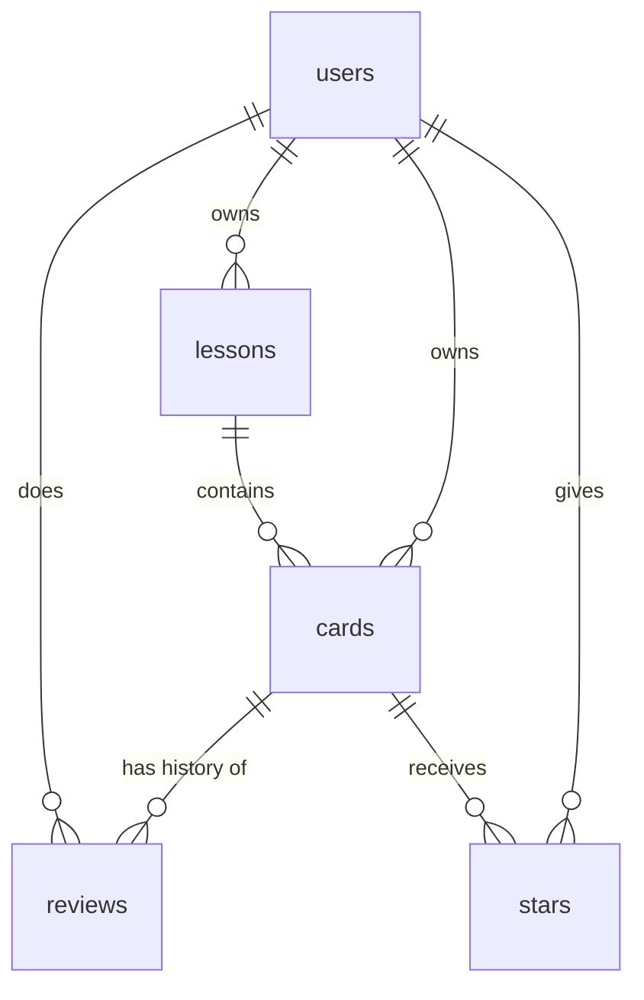

# korean-study-app
Intro to Code repo to build Korean study app

| Section  | Description | 
| -------- | -------- | 
| Pitch    | "I'm building a Korean-language study app because I want to be able to consistently revisit material and track how well I know it." I would like to use this app daily.   | 
| Features | See feature table below | 
| Database | See database section below. Cards mirror the "Vocab Bank" sheet of my textbook vocab spreadsheet (Korean_Vocab_Bank.xlsx). |
| Tests    | Your 2 required tests (below), each written as "Given ___, when ___, then ___." |
| Technologies | Your coding agent, database, how sign up and login will work, where you'll host it, any third party libraries / plugins. One sentence on why for each. |
| Design | The look and feel: colors, style, as well as an app or two you'd like to borrow inspiration from. |
| Risks and Cuts | The feature you're least sure you can build, and what you'll cut first if you run out of time. |

| Number | Feature  | User Story | 
| -------| -------- | -------- |
| 1 | Sign up and Log in | A new visitor can create their own account from inside your app, then log in and log out. Every account is a row in your users table. Each user sees only their own data. |
| 2 | Data Model | Data model	A users table plus at least 2 tables of your own, connected by a relationship (e.g., entries belong to categories). |
| 3 | Create / Read / Update / Delete | Add an item, view the list, open one item's detail page, edit it, and delete it with an "are you sure?" confirmation. |
| 4 | Validation | Required fields can't be left blank. Show a friendly message if someone tries. |
| 5 | Stars | Users can star items and see a "starred" view. All stars live in one stars table (a junction table) where each row references a user and an item: "this user starred this item." One table for everyone, not one per user. |
| 6 |Search | Search or filter, plus sort (e.g., newest first, highest rated). |
| 7 |Dashboard | At least one chart and 2–3 summary stats computed from your data (count, average, best month). |

## Database

The cards and lessons tables mirror the "Vocab Bank" sheet of my textbook spreadsheet, so its 257 rows can be imported directly.

| Spreadsheet column | Goes to |
| -------- | -------- |
| Lesson | lessons.number |
| Topic, e.g. 인사 (Greetings) | lessons.topic_korean + lessons.topic_english |
| Korean | cards.korean |
| Pronunciation, e.g. [학쌩] | cards.pronunciation |
| Polite form, e.g. 먹어요 | cards.polite_form |
| English meaning | cards.english |
| Notes | cards.notes |

**users**: one row per account

| Column | Type | Notes |
| -------- | -------- | -------- |
| id | number | primary key |
| email | text | required, unique |
| password_hash | text | required |
| created_at | date | |

**lessons**: one row per textbook lesson (5 so far)

| Column | Type | Notes |
| -------- | -------- | -------- |
| id | number | primary key |
| user_id | number | links to users.id |
| number | number | required, e.g. 1 |
| topic_korean | text | required, e.g. 인사 |
| topic_english | text | e.g. Greetings |

**cards**: one row per vocab word

| Column | Type | Notes |
| -------- | -------- | -------- |
| id | number | primary key |
| lesson_id | number | links to lessons.id |
| user_id | number | links to users.id |
| korean | text | required, e.g. 먹다. Not unique: the same word can have different meanings (개 = dog / counter for items) |
| pronunciation | text | optional, only when it differs from the spelling |
| polite_form | text | optional, mostly verbs and adjectives |
| english | text | required |
| example_sentence | text | optional, added by me (not in the spreadsheet) |
| notes | text | optional |
| created_at | date | |
| updated_at | date | |

**reviews**: one row each time I study a card

| Column | Type | Notes |
| -------- | -------- | -------- |
| id | number | primary key |
| card_id | number | links to cards.id |
| user_id | number | links to users.id |
| reviewed_at | date | |
| correct | true/false | |

**stars**: junction table, "this user starred this card"

| Column | Type | Notes |
| -------- | -------- | -------- |
| user_id | number | links to users.id |
| card_id | number | links to cards.id |
| created_at | date | |

Primary key is (user_id, card_id), so a card can only be starred once per user.

- One-to-many: user → lessons, lesson → cards, card → reviews
- Many-to-many: users ↔ cards through stars

| Planned feature	Shipped | Changed | Cut	Status (Done/Backlogged) |	Learning	What changed and why (one line) |
|------------------------ |---------|------------------------------|--------------------------------------------|
|You'll use this table in your reflection, so be honest. A plan that was wrong in interesting ways is worth more than one quietly edited to match.    |    |    |    |

